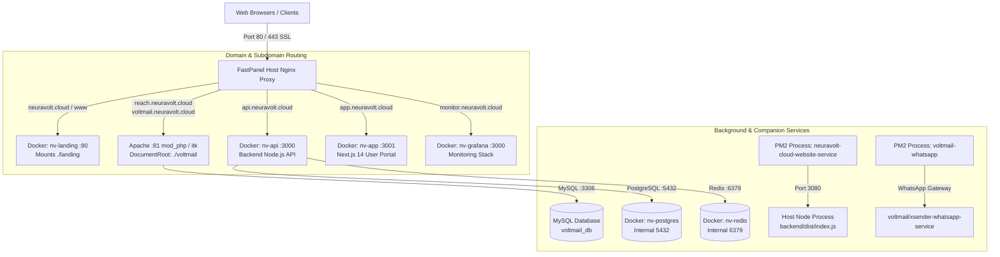

# NeuraVolt Cloud Services - Complete Technical Architecture & Infrastructure Guide

> **CRITICAL DEVELOPER & AI AGENT NOTICE**:  
> Read this document thoroughly before modifying any configuration, code, or deployment scripts in this repository. This document serves as the single source of truth for the NeuraVolt Cloud ecosystem running on `187.127.148.197`.

---

## 1. Executive Summary & Git Repository

| Attribute | Details |
| :--- | :--- |
| **Repository Name** | `neuravolt-technologies/neuravolt_cloud_services` |
| **Git Remote URL** | `git@github.com:neuravolt-technologies/neuravolt_cloud_services.git` |
| **Production Branch** | `main` |
| **Staging Branch** | `staging` |
| **Server Host IP** | `187.127.148.197` (Ubuntu Linux VPS) |
| **Control Panel** | FastPanel 2.x |
| **Target Deployment Directory**| `/var/www/neuravolt_cl_usr/data/www/neuravolt.cloud` |
| **FastPanel Site User** | `neuravolt_cl_usr` |
| **Server SSH User** | `root` |

---

## 2. High-Level Architecture Diagram



---

## 3. Subdomains, Ports & Service Routing Map

| Domain / Subdomain | Frontend Ingress | Backend Target | Codebase Path | Tech Stack | Description |
| :--- | :--- | :--- | :--- | :--- | :--- |
| `neuravolt.cloud`<br/>`www.neuravolt.cloud` | FastPanel Nginx (`443`) | Docker `nv-landing` (`172.19.0.3:80`) | `landing/` | Vanilla HTML5 / CSS3 / Modern JS | Main public website & service landing pages (21 pages). |
| `reach.neuravolt.cloud`<br/>`voltmail.neuravolt.cloud` | FastPanel Nginx (`443`) | Host Apache (`127.0.0.1:81`) | `voltmail/` (`voltmail/src/`) | PHP 8.x, Laravel 10, MySQL | Reach / Voltmail Cold Email & Multi-channel Outreach Platform. |
| `api.neuravolt.cloud` | FastPanel Nginx (`443`) | Docker `nv-api` (`:3000`) | `backend/` | Node.js, Express, TypeScript, Prisma, BullMQ | Cloud API, tenant management, instance control. |
| `app.neuravolt.cloud` | FastPanel Nginx (`443`) | Docker `nv-app` (`:3001`) | `app/` | Next.js 14, React 18, Tailwind/CSS | NeuraVolt Cloud Customer Console. |
| `admin.neuravolt.cloud` | FastPanel Nginx (`443`) | Docker `nv-admin` (`:3002`) | `admin/` | Next.js 14, React 18 | Internal Admin Operations Dashboard. |
| `monitor.neuravolt.cloud` | FastPanel Nginx (`443`) | Docker `nv-grafana` (`:3000`) | `monitoring/` | Prometheus, Grafana, Loki | Real-time server telemetry & metrics. |
| **PM2 Companion Service** | Host OS Local | `127.0.0.1:3080` | `backend/dist/index.js` | Node.js | Unique PM2 service: `neuravolt-cloud-website-service`. |

---

## 4. Directory & Codebase Breakdown

```
neuravolt_cloud_services/
├── .github/
│   └── workflows/
│       └── deploy.yml            # Automated CI/CD GitHub Actions Workflow
├── admin/                        # Admin Portal (Next.js 14)
├── app/                          # Customer Dashboard (Next.js 14)
│   ├── src/app/                  # App routes (billing, settings, dashboard)
│   └── package.json              # Requires: npm install --legacy-peer-deps
├── backend/                      # Cloud Backend API (Node.js TypeScript)
│   ├── prisma/                   # Prisma schema & database migrations
│   ├── src/                      # Express routers, BullMQ queue workers
│   └── package.json              # Requires: npm install --legacy-peer-deps
├── landing/                      # Public Landing Pages (21 HTML pages)
│   ├── index.html                # Main Home page
│   ├── cloud-hosting/            # Enterprise Web Hosting page
│   ├── cloud-vps/                # Dedicated VPS Compute page
│   ├── ai-automation-apps/       # AI Automation Apps page
│   ├── n8n-hosting/              # Managed n8n Automation page
│   ├── guardian-sre/             # Guardian SRE Defense page
│   ├── sla/                      # SLA Policy page
│   ├── privacy/ & terms/         # Legal & compliance pages
│   ├── assets/                   # Site images, logos, and webp graphics
│   └── style.css                 # Global landing stylesheet
├── voltmail/                     # Reach / Voltmail Application
│   ├── src/                      # Core active Laravel application
│   │   ├── app/                  # Controllers, Models, Mail services
│   │   ├── config/               # Laravel configuration
│   │   ├── resources/views/      # Blade templates (user, admin, partials)
│   │   ├── routes/               # user.php, admin.php, web.php, api.php
│   │   ├── storage/              # Cache, logs, sessions (must be writable)
│   │   └── .env                  # Database credentials & app configs
│   ├── xsender-whatsapp-service/ # Node.js WhatsApp automation daemon
│   └── addons/                   # Reach extensions and plugin modules
├── monitoring/                   # Prometheus, Loki, Promtail configs
├── traefik/                      # Internal proxy dynamic configs
├── docker-compose.yml            # Main Docker service definitions
├── deploy.sh                     # Automated deployment shell script
└── SYSTEM_ARCHITECTURE.md        # This technical architecture document
```

---

## 5. Port Safety & Collision Avoidance (CRITICAL)

The host server `187.127.148.197` runs multiple mission-critical systems and tenants. 

⛔ **STRICT PROCESS RULE - NEVER LISTEN ON OR KILL PROCESSES ON THESE PORTS**:
- **Port 80 / 443**: FastPanel Nginx Main Reverse Proxy & SSL Engine.
- **Port 81**: FastPanel Apache Web Backend (serves `reach.neuravolt.cloud`).
- **Port 3000**: Docker `nv-api` & PM2 `neuravolt_os-web`.
- **Port 3001**: Docker `nv-app` & PM2 `neuravolt_os-client`.
- **Port 3002**: Docker `nv-admin` & PM2 `ai-biometric-engine`.
- **Port 3306**: MySQL Database Server (`voltmail_db`).
- **Port 5432**: PostgreSQL Database (`nv-postgres`).
- **Port 6379**: Redis Queue Cache (`nv-redis`).
- **Port 8899 / 5000**: Lockiva services.
- **Port 5678**: n8n automation engine.

✅ **Allowed Port Range for New Host Processes**:
- Range: **`3010 – 3999`** (Excluding 3306).
- Assigned Website Service Port: **`3080`**.
- Assigned PM2 Process Name: **`neuravolt-cloud-website-service`**.

---

## 6. Automated CI/CD Workflow (`deploy.yml` & `deploy.sh`)

Every push to `main` or `staging` automatically triggers GitHub Actions to deploy directly to the VPS via SSH.

### Deployment Flow:
1. **GitHub Action Step**:
   - Workflow file: `.github/workflows/deploy.yml`.
   - Uses `appleboy/ssh-action@v1.0.3` with secrets (`SERVER_HOST`, `SERVER_USER`, `SERVER_SSH_KEY`, `SERVER_APP_DIR`).
   - Connects to `/var/www/neuravolt_cl_usr/data/www/neuravolt.cloud`.
2. **Git Sync**:
   - Fetches latest commits from `origin/main`.
   - Runs `git reset --hard origin/main` to cleanly align tracked files while safely preserving untracked server-only configs (`.env`, `voltmail/src/.env`, `postgres-data/`, `redis-data/`).
3. **Dependency Installation**:
   - Uses `npm install --legacy-peer-deps --no-audit` across `backend` and `app` to prevent peer dependency resolution errors (e.g. `bullmq` vs `redis`).
4. **Build Compilation**:
   - Backend: Runs `npx prisma generate` then `npm run build` (`tsc` -> `backend/dist/index.js`).
   - App: Runs `npm run build` (Next.js optimized production build).
5. **PM2 Service Restart**:
   - Restarts or starts `neuravolt-cloud-website-service` on assigned port `3080` with `--update-env`.
   - Saves PM2 state with `pm2 save`.
6. **Landing Cache Reload**:
   - Executes `docker exec nv-landing nginx -s reload` so static updates in `landing/` are immediately served.
7. **Reach (Voltmail) Cache Refresh**:
   - Clears Laravel caches in `voltmail/src`:
     `php artisan config:clear && php artisan cache:clear && php artisan view:clear`
     This ensures Reach remains responsive without 500 template errors.

---

## 7. Common Operational Playbooks

### A. Reach (`https://reach.neuravolt.cloud`) 500 Error
If Reach ever returns `500 Internal Server Error`, it is typically due to a stale Blade template or configuration cache.
**Instant Resolution**:
```bash
ssh root@187.127.148.197
cd /var/www/neuravolt_cl_usr/data/www/neuravolt.cloud/voltmail/src
php artisan config:clear
php artisan cache:clear
php artisan view:clear
```

### B. Checking PM2 Process Health
```bash
pm2 status neuravolt-cloud-website-service
pm2 logs neuravolt-cloud-website-service --lines 30 --nostream
```

### C. Updating Landing Page Content
1. Edit files locally in `landing/` (e.g., `landing/index.html`, `landing/style.css`).
2. Commit and push to `origin main`:
   ```bash
   git add landing/
   git commit -m "fix(landing): update content"
   git push origin main
   ```
3. GitHub Actions will auto-deploy within ~45 seconds.

### D. Restarting Docker Services
```bash
cd /var/www/neuravolt_cl_usr/data/www/neuravolt.cloud
docker-compose restart landing   # Reloads landing page container
docker-compose restart api       # Reloads cloud backend API
docker-compose restart app       # Reloads Next.js user app
```

---

## 8. Rules for Future Developers and AI Models
1. **Never delete `.env` or database folders**: Never run `git clean -fdx` or remove `postgres-data`, `redis-data`, `.env`, or `voltmail/src/.env`.
2. **Always use `--legacy-peer-deps`**: Any npm installation in `backend` or `app` must include `--legacy-peer-deps`.
3. **Never change system ports**: Keep `3080` for the Node service. Do not touch ports `3000`, `3001`, `3002`, `3306`, `5432`, `80`, or `81`.
4. **Preserve FastPanel ownership**: Files in `voltmail/` must remain accessible to system user `neuravolt_cl_usr`.
5. **Always test Reach after deployment**: Run `curl -I https://reach.neuravolt.cloud/` to verify HTTP `200 OK`.
